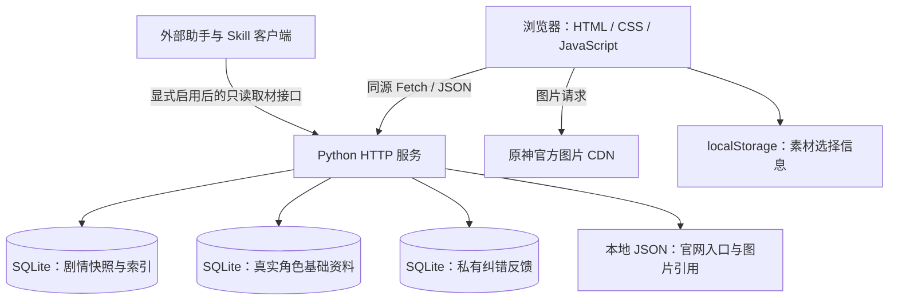

# 项目技术栈说明

更新日期：2026-10-16。Next.js 并行迁移已完成主要页面；下文区分当前实际实现与后续可选增强。

## 已确定的前端迁移目标

前端统一迁移到 **Next.js + TypeScript + shadcn/ui + Tailwind CSS**，不再按 Vue 或 React + Vite 方案推进。Python 数据业务逻辑与 SQLite 继续保留。

| 部分 | 确定方案 | 用途 |
| --- | --- | --- |
| 应用框架 | Next.js，使用 App Router | 页面组织、路由、服务端读取与页面渲染 |
| 组件体系 | React | Next.js 的界面基础，复用角色卡片、阅读器与来源组件 |
| 语言 | TypeScript，启用严格检查 | 组件属性、数据模型和接口调用的静态类型检查 |
| 通用组件 | shadcn/ui | 按需引入按钮、弹窗、筛选控件、移动端抽屉等；组件源码由项目维护 |
| 样式 | Tailwind CSS + CSS 主题变量 | 统一颜色、字体、间距与响应式布局，延续现有米白与墨绿风格 |
| 路由和基础请求 | Next.js 内置路由、Fetch API | 不额外引入 React Router、Vite 或 Axios |

React 是 Next.js 的组成基础，不是另一套并行方案。shadcn/ui 所需的底层组件依赖随实际生成的组件引入，不预先安装整套组件。

### 建议补充的工程工具

以下为建议配套，尚未安装；实际初始化时选择互相兼容的版本并提交锁文件。

| 工具 | 建议用途 |
| --- | --- |
| Node.js 受所选 Next.js 版本支持的 LTS 版本 | 开发、构建，以及使用 Next.js 服务端能力时的运行环境 |
| pnpm | 统一依赖管理，固定包管理器版本并提交 `pnpm-lock.yaml` |
| Zod | 在前端接口边界校验 Python 返回的 JSON；不替代后端数据校验 |
| Lucide React | 统一导航、按钮与状态图标 |
| ESLint + Next.js 规则、Prettier | 代码质量与格式检查 |
| Vitest + React Testing Library | 纯函数和客户端组件交互测试 |
| Playwright | 角色目录、详情、筛选、旧链接和移动端等端到端回归 |

暂不默认引入全局状态库。筛选、页码与版本放在 URL，局部交互使用 React 状态。后续出现明确需求再加入：复杂客户端请求缓存使用 TanStack Query，跨页面交互状态使用 Zustand，复杂表单使用 React Hook Form。图片、来源权限和撤下状态的缓存必须有显式失效规则。

Next.js 可以使用 React 自带的 `useState`、`useReducer` 与 Context。Context 用于向组件树共享值，通常结合状态 Hook 和 Provider 管理共享状态；这些交互能力放在客户端组件中。跨页面状态可放到共同布局下的 Provider，其生命周期取决于布局是否保留。刷新后若需恢复，应显式使用 URL、浏览器存储或后端持久化。Next.js 的路由和数据缓存不等同于应用的全局交互状态，也不要求额外安装 Zustand 或 Redux。

### 迁移约束与顺序

1. 建立 Next.js、TypeScript、shadcn/ui、Tailwind CSS 基础工程，配置主题、检查命令和 Python 接口访问。
2. 先迁移真实角色目录与详情，保留 124 条基础资料、120 组图片引用、筛选、分页与批次固定行为。
3. 再迁移搜索、阅读、素材、反馈与关系图，继续使用现有 Python 查询和校验逻辑。
4. 保留旧 `#/...` 地址的浏览器端兼容入口；URL fragment 不会发送到服务器，不能仅靠服务器重定向处理旧链接。
5. 保留现有官方图片直连方式；使用普通 `img` 或不经过优化代理的图片配置，不因迁移自动改成服务端缓存图片。
6. 涉及当前来源用途或撤下状态的读取显式采用动态读取 / 不缓存策略；固定批次基础资料另行定义缓存策略。
7. Python 与 Next.js 的内部调用需要正确处理 Host / Origin 和允许的接口范围，不通过放开所有跨域请求解决连接问题。
8. 新页面通过功能、类型、构建与浏览器回归后再切换入口；保留现有 Python 测试，避免同时重写已验证的后端业务。

**实施状态：Next.js 页面、共享应用壳和 Python API 代理已运行；旧 `web/` 原型仍保留作兼容入口。** 当前职责边界如下：Next.js 负责页面、路由、导航、客户端交互和轻量代理；Python 负责数据导入、来源准入、SQLite、查询索引、素材核验和维护脚本。真实正文仍受来源准入门禁约束。

---

当前项目采用 **HTML + CSS + 原生 JavaScript 前端、Python 标准库 HTTP 服务、SQLite 本地数据库**。目前是运行在本机的网页原型，启动现有网站无需安装第三方运行依赖，也无需执行前端打包。

## 1. 当前技术栈总览

| 层次 | 当前使用的技术 | 在项目中的用途 |
| --- | --- | --- |
| 页面结构 | HTML5 | 页面容器、导航、表单、角色资料与阅读内容 |
| 页面样式 | 原生 CSS、CSS Grid、Flexbox、媒体查询 | 角色卡片、详情布局、桌面与手机适配 |
| 前端逻辑 | 原生 JavaScript、ES Modules | 页面渲染、交互、筛选、分页和状态管理 |
| 前端路由 | URL Hash、URLSearchParams、History API | `#/real-characters` 等页面切换，保存筛选、页码与资料版本 |
| 前后端通信 | Fetch API、JSON、AbortController | 获取角色和剧情资料、提交反馈、取消过期请求 |
| 后端 | Python 3.10+ 标准库 | HTTP 接口、数据校验、查询、导入和维护脚本 |
| HTTP 服务 | `http.server.ThreadingHTTPServer`、`BaseHTTPRequestHandler` | 同时提供静态文件和 JSON 接口，处理并发请求 |
| 数据库 | SQLite、Python `sqlite3` | 剧情快照、查询索引、角色基础资料与私有反馈 |
| 数据交换 | JSON | 导入批次、来源记录、图片引用和 API 返回值 |
| 图谱展示 | 原生 SVG、Pointer Events | 绘制人物与关系，支持点击、拖拽和缩放 |
| 图谱图片导出 | Canvas、Blob、XMLSerializer | 将核验后的 SVG 图谱转换为 PNG |
| 浏览器存储 | localStorage | 保存素材清单中的 ID、主题等选择信息 |
| 图片展示 | HTML `img`、官方 CDN | 在线展示官网头像与立绘，支持懒加载和失败重试 |
| 自动化测试 | Python `unittest`、Node.js `node:test` | 后端、数据契约、前端纯逻辑及状态处理回归 |
| 版本管理 | Git、GitHub | 管理代码、文档、数据元信息和提交历史 |

## 2. 当前整体结构



浏览器与 Python 服务运行在同一网站地址下。Python 服务提供网页文件和业务接口；官方图片则由浏览器直接读取远程地址。

## 3. 前端实现

| 文件 | 职责 |
| --- | --- |
| [web/index.html](web/index.html) | 页面入口、导航与公共容器 |
| [web/styles.css](web/styles.css) | 全站样式、响应式布局和图片加载状态 |
| [web/app.js](web/app.js) | 路由、请求调度、剧情阅读、搜索、关系图与反馈页面 |
| [web/real-characters.mjs](web/real-characters.mjs) | 真实角色目录、筛选、详情、来源链接和图片展示 |
| [web/model.mjs](web/model.mjs) | 范围、关系类型、排序和展示所需的公共逻辑 |
| [web/materials.mjs](web/materials.mjs) | 素材选择、本地保存、重新核验与导出 |

前端使用浏览器原生模块加载，修改后刷新页面即可查看。路由、渲染和状态管理由项目代码实现，当前没有引入 React、Vue、TypeScript、Vite、Tailwind CSS 或第三方 UI 组件库。

关系图使用 SVG 绘制，交互由原生指针事件实现；图谱导出时使用 Canvas 转换图片。当前没有引入 D3、ECharts 或 Cytoscape。

## 4. 后端与数据库

服务入口是 [scripts/serve_prototype.py](scripts/serve_prototype.py)，使用 Python 标准库处理 HTTP 请求和响应。主要接口包括：

| 接口 | 用途 |
| --- | --- |
| `GET /api/character-catalog` | 真实角色目录或详情，附带独立的官网入口与图片引用 |
| `GET /api/search` | 剧情文本检索 |
| `GET /api/read` | 原文与上下文分页读取 |
| `GET /api/graph` | 局部人物关系图 |
| `GET /api/relationship` | 单条关系与证据 |
| `POST /api/materials` | 素材清单核验与导出数据处理 |
| `POST /api/feedback` | 提交本机纠错反馈 |
| `POST /api/ai-tools` | 显式启用后的助手只读取材入口 |

默认数据库位于 Git 忽略的 `data/local/`：

| 数据库 | 内容 |
| --- | --- |
| `archive.sqlite3` | 原创合成剧情、不可变快照、来源限制和查询索引 |
| `character-catalog.sqlite3` | 真实角色基础资料；按批次 ID 保存 JSON 内容与摘要 |
| `feedback.sqlite3` | 本机私有纠错反馈 |

数据库操作直接使用 SQL 和 `sqlite3`，没有 ORM。服务端当前没有引入 Flask、Django、FastAPI、PostgreSQL、MySQL 或 Redis。

## 5. 搜索与排序

剧情搜索主要由 [scripts/query_index.py](scripts/query_index.py)、[scripts/indexed_archive.py](scripts/indexed_archive.py) 和 [scripts/search_archive.py](scripts/search_archive.py) 实现。

- 使用 Unicode NFKC 与空白规范化处理文本。
- 支持连续原句包含匹配，以及空格分隔关键词的 AND 匹配。
- 自建三字符片段倒排索引，先缩小候选集合，再用 SQLite `instr` 精确复核。
- 使用可见范围覆盖索引、正文首尾片段索引和进程内缓存减少重复读取；片段无法确认命中时仍检查完整正文。
- 按可见段落连接进行拓扑排序，保留剧情阅读顺序；分页后再读取当前页正文。
- 使用 HMAC 签名游标绑定查询、快照及限制版本，识别失效的分页请求。

这些优化主要服务于原创剧情档案。124 条真实角色基础资料的目录筛选和分页目前由浏览器完成。

当前检索是字面文本检索，没有中文自动分词、向量数据库、Embedding 或语义检索。SQLite FTS5 曾用于方案对比实验，未接入当前运行查询链路。实现细节见 [索引读取链路](docs/index-pipeline.md)。

## 6. 真实数据与图片

角色基础资料来自社区项目 [genshin-db](https://github.com/theBowja/genshin-db)，保留固定提交、字段映射、文件摘要及许可证信息。现有新版批次包含 124 条中文记录；这一数量表示社区来源覆盖范围，不直接等于官方当前已实装名单。

基础字段的构建、校验与 SQLite 导入由 `build_character_catalog.py` 和 `character_catalog.py` 负责。官网入口与图片引用分别由 `character_references.py`、`character_art.py` 校验，并作为独立补充数据返回。

目前匹配了 120 名角色的官网头像与立绘：目录懒加载头像，详情加载立绘。项目保存图片 URL 和出处，图片文件由浏览器从以下官方域名在线读取：

- `uploadstatic.mihoyo.com`
- `webstatic.mihoyo.com`
- `act-webstatic.mihoyo.com`
- `fastcdn.mihoyo.com`

图片带有来源和版权标注，使用 `referrerpolicy="no-referrer"`。加载失败时保留基本资料并提供提示，详情支持重试。完整角色故事、对白与真实人物关系尚未接入；剧情检索和关系图仍使用原创合成样本。

## 7. AI 接入方式

AI 创作通过外部助手读取项目提供的 [Skill](skills/genshin-story-writer/SKILL.md) 和 Python 客户端完成。后端提供状态查询、搜索、段落、上下文、人物图谱和关系证据六类只读工具。

网站本身没有调用模型，也没有配置固定模型厂商、模型版本或模型 API Key。现有 HTTP 工具接口不是 MCP 服务；Node.js 也不是网站后端。具体启用方式见 [AI 连接方案](docs/ai-pipeline.md)。

## 8. 运行与检查

在项目根目录运行，使用与当前预览一致的端口：

```bash
python3 scripts/serve_prototype.py --port 4175
```

浏览器访问 [本地网站](http://127.0.0.1:4175)。如果省略 `--port`，默认端口是 `4173`。启动网站只需要 Python 3.10+；首次默认启动会初始化样本档案，并导入真实角色基础资料批次。

自动化检查命令：

```bash
# Python 测试
python3 -m unittest discover -s scripts -p 'test_*.py'

# 前端逻辑测试：需要支持 node:test 的 Node.js
node --test scripts/test_relationship_usage.mjs scripts/test_character_catalog_ui.mjs

# JavaScript 语法检查
node --check web/app.js
node --check web/real-characters.mjs

# 差异中的空白错误检查
git diff --check
```

项目还使用浏览器实际检查页面加载、图片显示、导航、筛选与手机布局；`scripts/benchmark_*.py` 提供合成数据性能测试。这些开发验证工具不属于网站运行时依赖。

## 9. 当前运行边界

当前服务只监听 `127.0.0.1`，实现了 Host / Origin 检查、CSP、输入校验与来源用途过滤。它仍是本机原型，没有公网用户认证、生产应用服务器、反向代理、容器编排或生产部署配置。

当前选择让项目能够直接运行和验证资料流程。后续如要多人使用或部署公网，需要按实际负载补充生产服务、鉴权和部署方案；这些尚未实现的内容不计入本页技术栈。
